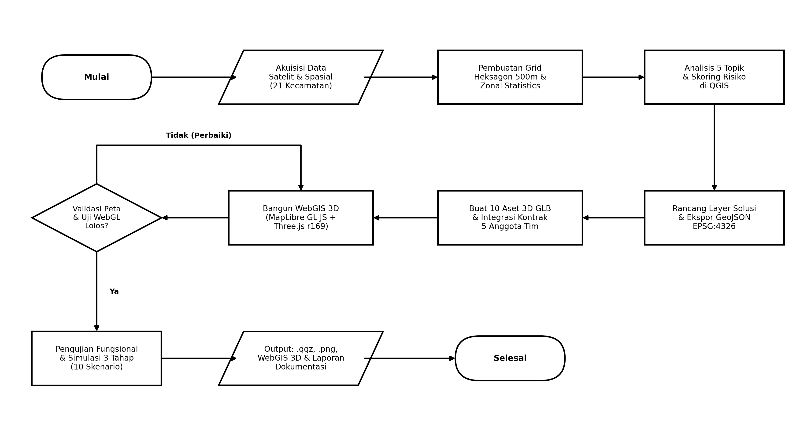
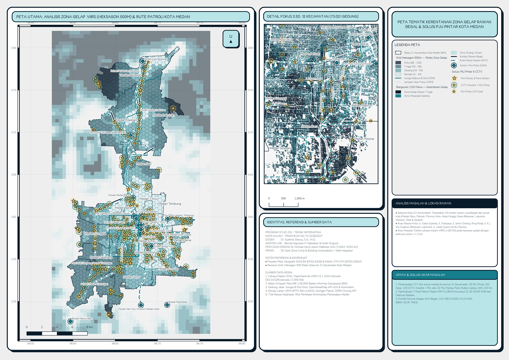
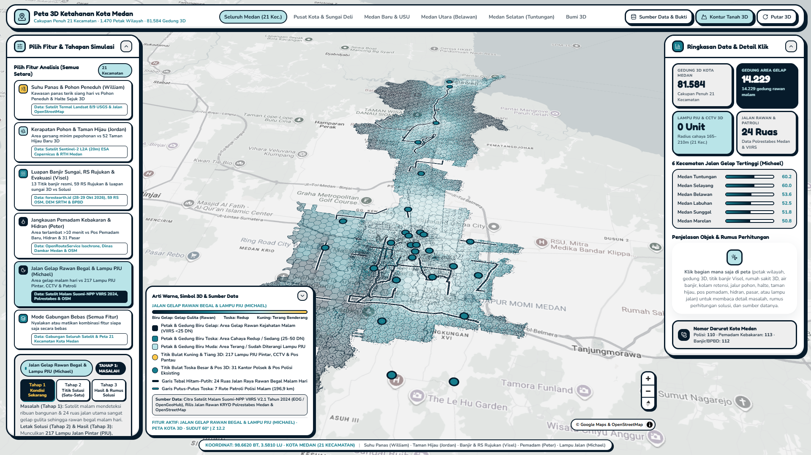
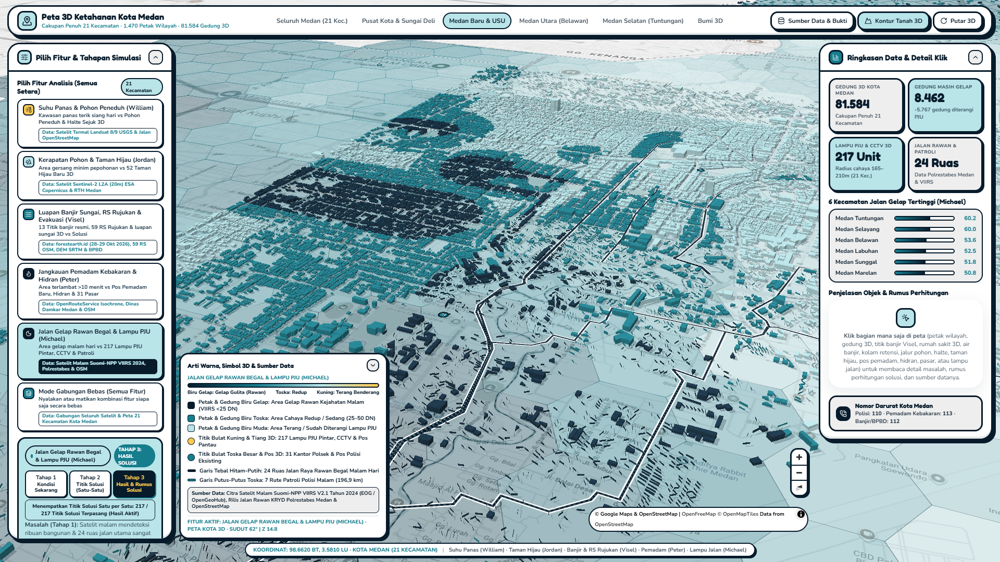
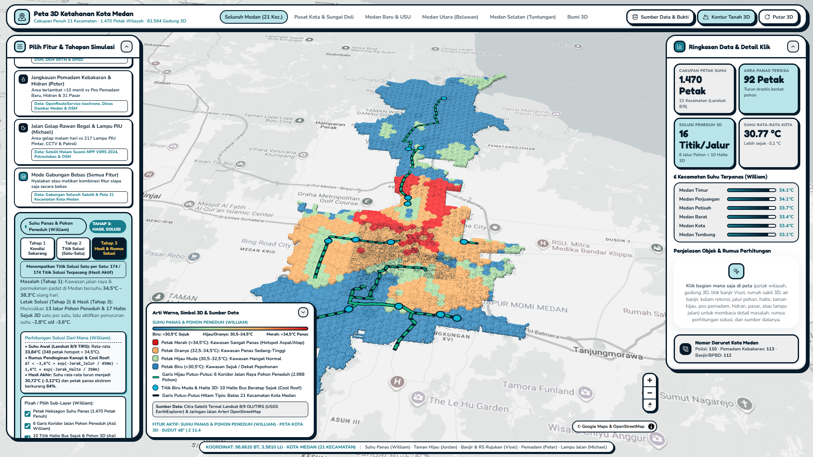
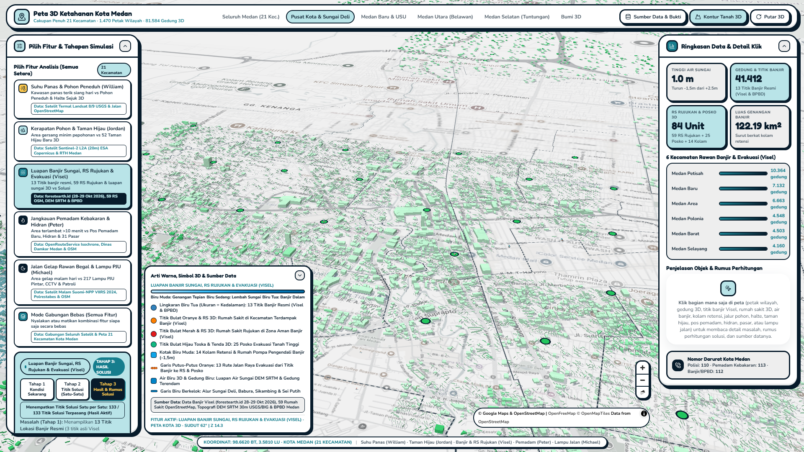
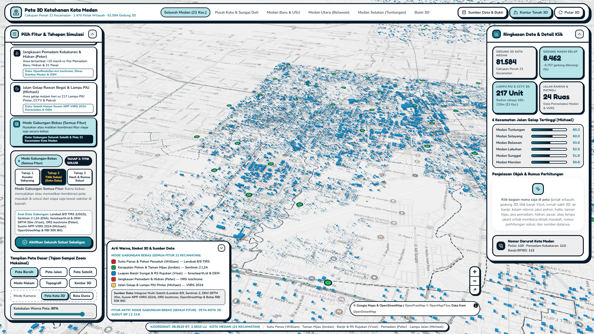
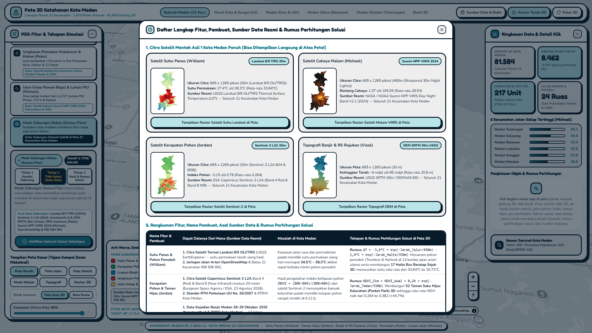
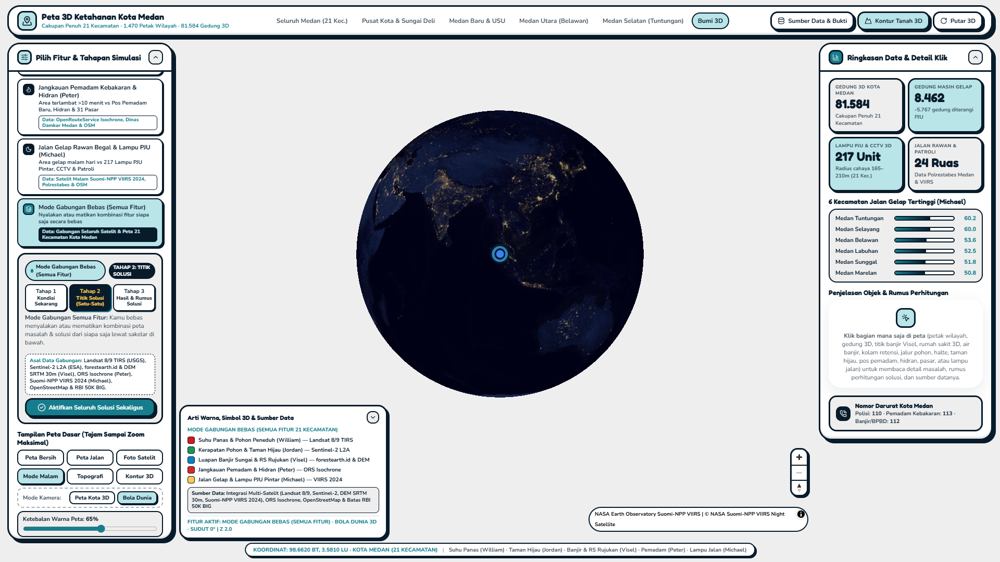

# DRAF ISI LAPORAN PROYEK
Judul: WEBGIS 3D KETAHANAN KOTA MEDAN BERBASIS CITRA SATELIT
Penyusun: Kelompok (5 Anggota: William, Jordan, Visel, Peter, Michael Deryl Aaron Matthew)
Kelas: KOM A2’24
Mata Kuliah: Praktikum Sistem Informasi Geografis

---

## KATA PENGANTAR

Puji syukur penulis panjatkan ke hadirat Tuhan Yang Maha Esa atas rahmat-Nya sehingga laporan ini selesai tepat waktu. Laporan ini mendokumentasikan proyek berjudul "WebGIS 3D Ketahanan Kota Medan Berbasis Citra Satelit". Penyusunan karya ini merupakan syarat akhir mata kuliah Praktikum Sistem Informasi Geografis pada Program Studi D-3 Teknik Informatika, Fakultas Vokasi, Universitas Sumatera Utara.

Penulis mengucapkan terima kasih kepada Bapak Dr. Syahriol Sitorus, S.Si., M.IT. (NIP 197103101997031004) selaku dosen pengampu atas bimbingan selama perkuliahan. Ucapan terima kasih juga ditujukan kepada Saudara Andri Wiguna selaku asisten laboratorium. Beliau telah mendampingi proses praktikum, pengujian aplikasi, dan penyusunan proyek bersama rekan tim.

Penulis menyadari bahwa laporan dan aplikasi ini masih punya keterbatasan pada cakupan data maupun tampilan antarmuka. Kritik serta saran yang membangun sangat penulis harapkan demi perbaikan di masa mendatang.

Medan, Desember 2026

Penulis

---

## BAB 1 PENDAHULUAN

### 1.1	Latar Belakang

Kota Medan menghadapi tekanan lingkungan dan keselamatan warga di tengah pertumbuhan kawasan terbangun yang cepat. Pekerja maupun mahasiswa yang melintas di jalan arteri saat siang sering merasakan panas terik akibat minimnya pohon peneduh. Riset penginderaan jauh di Medan mencatat kenaikan *land surface temperature* (LST) sejalan dengan berkurangnya vegetasi (Pohan & Sulistiyono, 2023). Pola *urban heat island* (UHI) tersebut terus meluas terutama pada koridor komersial dan permukiman padat di pusat kota (Putri et al., 2025).

Masalah lain muncul saat hujan deras mengguyur kawasan hulu dan merendam rumah warga di bantaran Sungai Deli, Babura, serta Belawan. Warga pada cekungan sungai butuh informasi rute evakuasi menuju posko aman dan rumah sakit rujukan terdekat. Keterlambatan penanganan juga kerap terjadi pada kejadian kebakaran di permukiman gang sempit karena sebaran pos pemadam terbatas. Analisis jaringan jalan pada kota besar membuktikan bahwa beberapa kecamatan pinggiran berada di luar jangkauan layanan cepat pemadam (Evalianto et al., 2024).

Kejahatan jalanan pada malam hari ikut mengancam pengendara yang melewati ruas jalan penghubung tanpa penerangan memadai. Pencatatan cahaya malam dari satelit Suomi-NPP VIIRS mampu membedakan kawasan terang dan kantong gelap secara terukur (Elvidge et al., 2021). Peta tematik biasa yang hanya memakai poligon batas kecamatan datar sering gagal memperlihatkan titik risiko di tingkat tapak bangunan.

Kelompok kami merancang aplikasi *WebGIS* 3D Ketahanan Kota Medan untuk menyatukan kelima persoalan tersebut dalam satu peta interaktif. Aplikasi ini mengolah citra satelit Landsat 8/9, Sentinel-2, VIIRS, dan data elevasi SRTM ke dalam grid heksagon 500 meter. Data tersebut digabung dengan 81.584 tapak bangunan 3D di 21 kecamatan bersama simulasi solusi fisik supaya dampak intervensi bisa langsung terlihat.

### 1.2	Rumusan Masalah

Lima persoalan perkotaan yang saling berkaitan di Kota Medan menuntut pendekatan pemetaan terpadu. Rumusan masalah dalam proyek ini disusun dalam lima pertanyaan berikut:

1. Bagaimana memetakan sebaran *hotspot* suhu permukaan Landsat 8/9 dan defisit ruang hijau Sentinel-2 ke grid heksagon 500 meter beserta rekomendasi peneduh dan taman saku?
2. Bagaimana memodelkan genangan luapan sungai berbasis elevasi DEM SRTM dan titik banjir resmi serta menentukan lokasi posko dan rute ke rumah sakit rujukan?
3. Bagaimana mendeteksi zona *blindspot* layanan pemadam di atas sepuluh menit memakai *isochrone* jaringan jalan serta menentukan lokasi pos pemadam dan hidran baru?
4. Bagaimana melacak jalan gelap rawan kejahatan malam berbasis citra VIIRS 2024 dan merancang penempatan lampu jalan pintar beserta rute patroli?
5. Bagaimana menyatukan hasil olahan QGIS kelima anggota tim dan aset model 3D Blender ke dalam satu aplikasi *WebGIS* 3D yang mudah dipakai?

### 1.3	Batasan Masalah

Pengerjaan proyek berlangsung dalam jadwal tiga minggu sehingga ruang lingkup sistem perlu dijaga agar tetap fokus. Batasan masalah dalam pengembangan proyek ini meliputi lima hal berikut:

1. Wilayah kajian mencakup seluruh 21 kecamatan di Kota Medan mengacu pada batas Peta Rupabumi Indonesia (RBI) skala 1:50.000 Badan Informasi Geospasial.
2. Analisis spasial tingkat kota dibagi menjadi 1.470 sel grid heksagon berukuran 500 meter pada sistem UTM Zona 47N lalu diekspor ke GeoJSON WGS 84.
3. Sumber data memakai repositori publik terbuka, yakni Landsat 8/9 TIRS, Sentinel-2 L2A, VIIRS V2.1 2024, DEM SRTM 30 meter, OpenStreetMap, dan catatan banjir Medan.
4. Aplikasi *WebGIS* dibangun memakai MapLibre GL JS dan Three.js tanpa bergantung pada kunci API peta komersial berbayar di sisi *client-side*.
5. Pengujian difokuskan pada kelayakan fitur antarmuka, pemuatan model 3D GLB, dan simulasi tiga tahap pada peramban desktop modern.

### 1.4	Tujuan Proyek

Setiap tujuan proyek dirancang untuk menjawab rumusan masalah secara langsung dan terukur. Tujuan yang ingin dicapai dari pengerjaan proyek ini adalah sebagai berikut:

1. Menghasilkan peta grid heksagon suhu permukaan dan indeks kehijauan Kota Medan lengkap dengan simulasi pendinginan jalur pohon peneduh, halte sejuk, serta taman saku.
2. Menghasilkan model genangan lembah sungai berbasis DEM SRTM beserta simulasi kolam retensi, lokasi posko aman, dan rute evakuasi menuju rumah sakit rujukan.
3. Menghasilkan peta zona *blindspot* pemadam kebakaran berbasis *isochrone* jaringan jalan beserta rekomendasi titik pos pemadam baru dan hidran di dekat pasar tradisional.
4. Menghasilkan pemetaan kerawanan malam pada 81.584 bangunan dan 24 ruas jalan rawan beserta penempatan titik lampu jalan pintar, kamera pengawas, pos pantau, dan patroli.
5. Membangun aplikasi *WebGIS* 3D terpadu yang menyatukan seluruh layer *vector*, *raster* satelit asli, dan sepuluh jenis aset 3D Blender dalam simulasi tiga tahap.

### 1.5	Manfaat Proyek

Hasil pembangunan sistem pemetaan tiga dimensi ini diharapkan memberi nilai guna di luar kegiatan praktikum. Manfaat proyek ini terbagi bagi tiga pihak berikut:

1. Bagi penulis, proyek ini melatih keterampilan mengolah citra satelit di QGIS, membuat aset 3D, dan membangun *WebGIS* berbasis WebGL.
2. Bagi pemerintah daerah, peta interaktif ini bisa menjadi acuan awal penentuan lokasi pohon peneduh, kolam retensi, pos pemadam, dan lampu jalan.
3. Bagi pengembang lain, dokumentasi beserta repositori terbuka proyek ini dapat dijadikan rujukan membangun *WebGIS* 3D multi-topik tanpa biaya lisensi.

---

## BAB 2 LANDASAN TEORI

### 2.1	Sistem Informasi Geografis dan QGIS

Sistem Informasi Geografis (SIG) adalah sistem komputer untuk menyimpan, memeriksa, mengolah, dan menyajikan data yang terikat pada koordinat permukaan bumi. Data di dalam SIG terdiri atas dua bentuk utama, yakni data *vector* (titik, garis, poligon) dan data *raster* (matriks piksel citra). Aplikasi SIG modern memakai analisis tumpang susun dan analisis jaringan jalan guna mendukung keputusan tata ruang kota (Evalianto et al., 2024).

Proyek ini memakai perangkat lunak *open source* QGIS versi 3.40 sebagai alat pengolah data spasial utama. QGIS menyediakan modul *zonal statistics* untuk menghitung nilai rata-rata, minimum, dan maksimum piksel *raster* pada tiap poligon wilayah (QGIS Development Team, 2025). Peta yang selesai diolah kemudian disusun menjadi peta cetak resolusi tinggi lewat fitur *print layout* dan diekspor ke format GeoJSON.

### 2.2	Penginderaan Jauh Citra Satelit

Penginderaan jauh memungkinkan pemantauan kondisi fisik permukaan kota secara luas tanpa harus mengukur langsung setiap lokasi di lapangan. Sensor satelit merekam pantulan cahaya tampak, inframerah dekat, radiasi termal, cahaya malam, hingga gelombang radar ketinggian lahan.

#### 2.2.1	Citra Cahaya Malam VIIRS dan Suhu Permukaan Landsat

Sensor *Visible Infrared Imaging Radiometer Suite* (VIIRS) pada satelit Suomi-NPP membawa saluran *Day/Night Band* yang peka menangkap cahaya lampu kota pada malam hari. Produk tahunan VIIRS V2 menyaring gangguan awan, kilat, dan pantulan bulan supaya nilai radiansi malam antarwilayah bisa dibandingkan konsisten (Elvidge et al., 2021). Di proyek ini, data VIIRS 2024 dipakai pada fitur keamanan malam milik Michael untuk melacak ruas jalan dan blok gedung di zona gelap.

Pemetaan suhu permukaan siang hari memakai saluran termal satelit Landsat 8 dan 9 *Operational Land Imager / Thermal Infrared Sensor* (OLI/TIRS). Pengolahan saluran termal Landsat di Kota Medan mampu melacak pergeseran kawasan sejuk menjadi zona *urban heat island* akibat penambahan bangunan (Pohan & Sulistiyono, 2023). Riset lain di Medan dengan citra Landsat menunjukkan suhu permukaan tertinggi selalu terkumpul pada kawasan pusat kota yang padat (Putri et al., 2025). Data suhu Landsat tersebut dipakai oleh topik William sebagai dasar simulasi jalur pohon peneduh.

#### 2.2.2	Indeks Vegetasi Sentinel-2 dan Model Elevasi DEM SRTM

Satelit Copernicus Sentinel-2 L2A merekam tutupan permukaan bumi pada resolusi 10 hingga 20 meter lewat saluran merah (B04) dan inframerah dekat (B08). Dari kedua saluran itu, kerapatan tanaman dapat dihitung memakai rumus *normalized difference vegetation index* (NDVI). Nilai NDVI mendekati nol atau negatif menandakan bangunan dan air, sedangkan nilai tinggi menandakan kanopi pohon rimbun (Sufrianto et al., 2025). Topik Jordan memakai olahan NDVI Sentinel-2 untuk mendeteksi kelurahan gersang dan menempatkan 52 titik taman saku baru.

Pemodelan banjir kota butuh data ketinggian permukaan tanah dari *Digital Elevation Model* (DEM) *Shuttle Radar Topography Mission* (SRTM) resolusi 30 meter. Elevasi mentah sering kurang tepat jika dipakai langsung tanpa melihat jarak suatu lahan ke alur sungai terdekat. Metode *height above nearest drainage* (HAND) mengatasi hal itu dengan menghitung selisih tinggi lahan terhadap dasar alur sungai pengalirnya (Hu & Demir, 2021). Topik Visel memakai pendekatan HAND berbasis *client-side* dan DEM SRTM agar genangan 3D mengikuti lembah Sungai Deli, Babura, dan Belawan.

### 2.3	Analisis Spasial Berbasis Grid Heksagon dan *Isochrone*

Batas kecamatan di kota besar punya bentuk dan luas yang timpang sehingga berisiko memunculkan bias saat membandingkan kepadatan masalah antarwilayah. Pembagian wilayah studi ke dalam sel grid seragam menjadi cara efektif untuk meratakan satuan pengamatan. Riset mengenai pembagian grid spasial membuktikan bahwa ukuran grid memengaruhi ketajaman pola keruangan yang terbaca dari data perkotaan (Luo et al., 2021). Kajian evaluasi infrastruktur dasar juga menunjukkan bahwa grid 500 meter mampu menjaga keseimbangan antara detail lokal dan kestabilan statistik wilayah (Kang et al., 2021).

Kelima topik di proyek ini memakai satu master grid berisi 1.470 poligon heksagon berukuran 500 meter agar seluruh data terhubung tepat lewat kunci `hex_id`. Bentuk heksagon dipilih karena jarak dari pusat sel ke enam sel tetangga sama rata, berbeda dengan persegi yang jarak diagonalnya lebih panjang.

Analisis layanan darurat pemadam kebakaran tidak memakai lingkaran *buffer* biasa karena truk pemadam wajib mengikuti jalan raya yang berbelok. Sebagai gantinya, sistem memakai poligon *isochrone* dari layanan OpenRouteService menurut waktu tempuh berkendara lima dan sepuluh menit. Penerapan analisis jaringan jalan pada pemetaan pos pemadam terbukti mampu mengungkap kantong *blindspot* yang luput oleh jarak garis lurus (Evalianto et al., 2024). Topik Peter memadukan poligon *isochrone* tersebut dengan operasi selisih geometri di QGIS untuk menentukan lokasi pos pemadam dan hidran baru.

### 2.4	Teknologi *WebGIS* 3D dan Standar Data Spasial

Penyajian peta melalui peramban web memudahkan warga maupun pemerintah memeriksa hasil analisis spasial tanpa harus memasang perangkat lunak SIG desktop. Seluruh komponen peta dibangun memakai standar terbuka agar bisa berjalan ringan di komputer biasa.

#### 2.4.1	Format Data GeoJSON dan *MapLibre GL JS*

Pertukaran layer *vector* antara QGIS dan aplikasi web dalam proyek ini memakai standar GeoJSON sesuai spesifikasi RFC 7946. Standar itu mewajibkan koordinat disimpan pada sistem referensi geografis WGS 84 (`EPSG:4326`) dalam format titik, garis, dan poligon (Butler et al., 2016). Pemakaian satu proyeksi baku mencegah pergeseran posisi ketika layer lima anggota ditumpuk serentak pada satu layar peta.

Untuk merender puluhan ribu tapak gedung dan ribuan sel heksagon secara halus, aplikasi memakai pustaka *open source* MapLibre GL JS. MapLibre memanfaatkan akselerasi WebGL pada perangkat pengguna serta mendukung peralihan mulus antara proyeksi datar Mercator dan bola bumi 3D (MapLibre Organization, 2025). Arsitektur *rendering* MapLibre dirancang guna menjaga kecepatan bingkai gambar tinggi pada aplikasi peta web maupun seluler (Ammann et al., 2022). Perintah *fill-extrusion* pada MapLibre mengangkat 81.584 tapak gedung dan 1.470 heksagon menjadi balok 3D sesuai atribut tingginya.

#### 2.4.2	Pemodelan Aset 3D *Three.js* dan Animasi Antarmuka

MapLibre unggul saat mengekstrusi balok bangunan sederhana, tetapi bentuk detail seperti tiang lampu, pohon, halte, dan rumah sakit butuh mesin 3D khusus. Aplikasi menggabungkan pustaka Three.js r169 lewat mekanisme *custom layer* yang berbagi konteks WebGL bersama kanvas MapLibre (Three.js Authors, 2025). Sepuluh aset 3D dibuat secara *headless* dengan skrip Python di Blender 4.4.3 lalu diekspor ke format `.glb` dan dimuat lewat `GLTFLoader`.

Antarmuka pengguna memakai gaya kartu kontras tinggi agar mudah dibaca tanpa bergantung pada *framework* antarmuka berat. Perubahan angka statistik serta gelombang kenaikan muka air banjir dianimasikan memakai pustaka Anime.js v4. Seluruh ikon tombol memakai format vektor Lucide SVG supaya tetap tajam pada layar resolusi tinggi.

---

## BAB 3 PERANCANGAN PROYEK

### 3.1	Diagram Pengerjaan Proyek

Pengerjaan proyek dibagi ke dalam dua jalur paralel yang diikat oleh satu kontrak struktur data terpadu. Empat anggota tim mengolah citra satelit dan jaringan jalan untuk topik masing-masing di QGIS hingga menghasilkan berkas `.qgz`, peta `.png`, dan berkas GeoJSON. Anggota kelima mengerjakan analisis zona gelap VIIRS sekaligus merakit aset 3D Blender dan membangun aplikasi *WebGIS* 3D.

Seluruh layer yang masuk ke aplikasi web mengacu pada dua berkas induk di folder `data/integrasi_tim/`. Berkas tersebut adalah `batas_kecamatan_medan.geojson` berisi 21 kecamatan dan `master_hex_500m_template.geojson` berisi 1.470 sel heksagon berkunci `hex_id`. Penyatuan skema kolom memastikan fitur klik objek dan mode gabungan berjalan tanpa bentrok koordinat.

#### 3.1.1	*Flowchart* (Alur Pembuatan Proyek)

Tahapan pembuatan proyek disusun berurutan supaya pengerjaan paralel antaranggota tetap menghasilkan satu sistem utuh. Alur kerja mulai dari pengumpulan data satelit hingga pengujian *WebGIS* 3D dapat dilihat pada Gambar 3.1.



Gambar 3.1 *Flowchart* Alur Pembuatan Proyek

Pada Gambar 3.1, proses diawali akuisisi data satelit resmi dan OpenStreetMap untuk cakupan 21 kecamatan Kota Medan. Tahap selanjutnya adalah pembuatan grid heksagon 500 meter serta ekstraksi nilai piksel memakai *zonal statistics* di QGIS. Setelah layer solusi selesai diekspor ke GeoJSON, alur berlanjut ke pembuatan sepuluh aset model `.glb` dan integrasi kode MapLibre GL JS bersama Three.js. Jika validasi peta atau pengujian WebGL belum lolos, alur kembali ke tahap perbaikan *script* aplikasi sebelum merilis luaran akhir proyek.

### 3.2	Jadwal Penelitian

Proyek ini dikerjakan selama tiga minggu penuh mulai tanggal 16 November 2026 sampai 6 Desember 2026. Rincian pembagian waktu kerja harian untuk setiap tahapan kegiatan tercantum pada Tabel 3.1.

Tabel 3.1 Jadwal Penelitian

| No | Judul Kegiatan | Minggu 1 (16-22 Nov) | Minggu 2 (23-29 Nov) | Minggu 3 (30 Nov-6 Des) |
|---|---|---|---|---|
| 1 | Identifikasi Masalah | S S R K | | |
| 2 | Analisis Kebutuhan | K J S | | |
| 3 | Studi Literatur | J S M | S S | |
| 4 | Perancangan Konsep Proyek | | S R K J | |
| 5 | Implementasi Proyek (*Coding*) | | K J S M | S S R |
| 6 | Pengujian Proyek | | | R K J |
| 7 | Pengembangan Fitur Proyek | | | K J S |
| 8 | Penyusunan Laporan Akhir | | | J S M |

Pada minggu pertama, tim menyepakati lima tema ketahanan Kota Medan, mengunduh citra satelit terbuka, dan membagi peran kerja. [ISI: Nama Lengkap William] (NIM [ISI: NIM William]) mengolah suhu panas Landsat serta jalur peneduh. [ISI: Nama Lengkap Jordan] (NIM [ISI: NIM Jordan]) mengolah indeks NDVI Sentinel-2 serta taman saku. Bagian kebencanaan dikerjakan oleh [ISI: Nama Lengkap Visel] (NIM [ISI: NIM Visel]) pada topik cekungan banjir DEM SRTM, data banjir lokal, dan rumah sakit rujukan.

Sementara itu, [ISI: Nama Lengkap Peter] (NIM [ISI: NIM Peter]) mengerjakan *isochrone* jangkauan pemadam kebakaran beserta hidran darurat. Michael Deryl Aaron Matthew (NIM 241712042) mengolah zona gelap VIIRS, 81.584 bangunan 3D, sepuluh model Blender, dan integrasi penuh *WebGIS* 3D. Minggu kedua hingga ketiga diisi penyusunan berkas QGIS, penulisan kode di `web-peta-interaktif/`, pengujian sepuluh skenario Playwright, serta penyusunan laporan akhir ini.

---

## BAB 4 HASIL

### 4.1	Hasil Perancangan Proyek

Aplikasi *WebGIS* 3D Ketahanan Kota Medan berhasil menyatukan seluruh layer masalah dan solusi dari lima anggota tim ke dalam satu peramban web. Seluruh data *vector* dan *raster* tersimpan di folder `web-peta-interaktif/data/` sehingga aplikasi bisa dibuka secara lokal lewat peladen Python pada berkas `JALANKAN_PETA_3D.bat`.

#### 4.1.1	Hasil Analisis Spasial Lima Topik Ketahanan Kota Medan

Pengolahan data di QGIS menghasilkan lima paket analisis yang mencakup seluruh 21 kecamatan Kota Medan pada grid 1.470 sel heksagon 500 meter. Untuk tema kelima mengenai zona gelap rawan begal, hasil pemetaan desktop juga dicetak ke peta tematik 300 DPI seperti tampak pada Gambar 4.1.



Gambar 4.1 *Layout* Peta Tematik QGIS Zona Gelap Kota Medan

Gambar 4.1 memperlihatkan peta cetak proyek `Medan_DarkZone_Crime_Orang5.qgz` yang menggabungkan gradasi cahaya malam VIIRS 2024 dengan 24 ruas jalan rawan kejahatan. Di atas peta tersebut tampil pula 31 kantor polisi eksisting, 217 titik lampu jalan pintar, dan 7 rute patroli malam sepanjang 196,92 km. Radiansi VIIRS Kota Medan memiliki rata-rata 28,53 DN dengan rentang 1,07 hingga 105,05 DN pada citra 665 kali 1.265 piksel. Rekapitulasi data masukan serta capaian solusi terukur untuk kelima topik disajikan pada Tabel 4.1.

Tabel 4.1 Ringkasan Data Spasial dan Solusi Lima Topik Analisis

| No | Topik dan Penanggung Jawab | Sumber Data Utama | Kondisi Awal (Masalah) | Solusi 3D dan Dampak Terukur |
|---|---|---|---|---|
| 1 | Suhu Panas dan Pohon Peneduh (William) | Citra Landsat 8/9 TIRS 30m dan jalan OpenStreetMap | Suhu rata-rata kota 32,32°C dan *hotspot* mencapai 38,3°C | 6 koridor pohon peneduh dan 10 halte sejuk; suhu rata-rata turun ke 30,77°C |
| 2 | Kerapatan Pohon dan Taman Hijau (Jordan) | Citra Sentinel-2 L2A 20m (B04 dan B08) serta data RTH | Indeks NDVI rata-rata awal 0,302 (banyak blok gersang <= 0,111) | Penambahan 52 taman saku hijau 3D; rata-rata NDVI naik menjadi 0,382 |
| 3 | Luapan Banjir, Rumah Sakit, dan Evakuasi (Visel) | DEM SRTM 30m, model HAND, 13 titik banjir, 59 rumah sakit | Luas genangan awal pada skenario +2,5 m mencapai 234,33 km² | 14 kolam retensi, 25 posko, dan 13 rute evakuasi; genangan surut ke 122,19 km² |
| 4 | Jangkauan Pemadam dan Hidran (Peter) | OpenRouteService *Isochrone*, 2 pos lama, 31 pasar tradisional | Sebanyak 383.754 unit bangunan pada sel heksagon di luar jangkauan 10 menit | 16 pos pemadam baru dan 11 hidran; bangunan terlambat tersisa 2.710 unit |
| 5 | Jalan Gelap dan Lampu PJU (Michael) | Citra VIIRS 2024, 81.584 bangunan 3D, rilis Polrestabes Medan | Tercatat 14.229 gedung gelap di sepanjang 24 ruas jalan rawan | 217 lampu PJU, CCTV, pos pantau, dan 7 rute patroli; sisa gedung gelap 8.462 unit |

#### 4.1.2	Implementasi *WebGIS* 3D dan Aset Model Blender

Tampilan 3D di aplikasi memakai dua lapis grafis yang bekerja serentak pada satu kanvas WebGL. Lapisan pertama memanfaatkan fitur *fill-extrusion* MapLibre GL JS untuk mengangkat 81.584 tapak gedung OpenStreetMap dan 1.470 sel heksagon. Potongan kode dari berkas `web-peta-interaktif/app.js` di bawah ini mengatur tinggi dan gradasi warna balok heksagon 3D berdasarkan skor kerawanan tiap sel:

```javascript
map.addLayer({
  id: "hex-3d-extrusion",
  type: "fill-extrusion",
  source: "src-hex",
  layout: { visibility: "none" },
  paint: {
    "fill-extrusion-color": ["interpolate", ["linear"], ["get", "risk_score"], 20, PAL.ice, 45, PAL.teal, 70, PAL.ink],
    "fill-extrusion-height": ["*", ["get", "risk_score"], 5.5],
    "fill-extrusion-opacity": 0.84,
    "fill-extrusion-vertical-gradient": true,
  },
});
```

Lapisan kedua memakai *custom layer* Three.js r169 untuk merender model 3D detail hasil ekspor Blender 4.4.3 dalam format `.glb`. Ada sepuluh templat `.glb` yang dimuat oleh `GLTFLoader`, yakni `pju_smart.glb`, `cctv_pole.glb`, `pos_pantau.glb`, `police_post.glb`, `halte_teduh.glb`, `pohon_peneduh.glb`, `posko_evakuasi.glb`, `hidran_darurat.glb`, `pos_damkar.glb`, dan `rs_rujukan.glb`. Sebanyak 597 instansi model 3D diletakkan tepat pada koordinat bumi memakai konversi `MercatorCoordinate` seperti pada kode `web-peta-interaktif/app.js` berikut:

```javascript
rawData.solusi_pju_cctv.features.forEach((feat, idx) => {
  const jenis = String(feat.properties.jenis_solusi || "");
  const key = jenis.includes("Pos Pantau")
    ? "pos_pantau"
    : jenis.includes("CCTV") ? "cctv_pole" : "pju_smart";
  const tpl = loadedTemplates[key];
  if (!tpl) return;
  const clone = tpl.clone(true);
  const [lon, lat] = feat.geometry.coordinates;
  const mc = maplibregl.MercatorCoordinate.fromLngLat([lon, lat], 0);
  clone.position.set((mc.x - originMc.x) / scaleUnit, 0, (mc.y - originMc.y) / scaleUnit);
  clone.scale.setScalar(2.5);
  clone.userData = { stepOrder: Number(feat.properties.step_order || idx + 1) };
  pjuGroup.add(clone);
  placedItems.push({ obj: clone, lngLat: [lon, lat] });
});
```

Aplikasi dilengkapi mesin simulasi tiga tahap yang seragam untuk lima topik. Tahap 1 menampilkan kondisi masalah, Tahap 2 memunculkan titik solusi satu per satu, dan Tahap 3 mengaktifkan perhitungan dampak fisik. Pengujian otomatis *black box testing* dijalankan memakai skrip Python Playwright pada Google Chrome resolusi 1920 kali 1080 piksel. Seluruh sepuluh skenario uji berjalan tanpa satu pun galat konsol seperti dirangkum pada Tabel 4.2.

Tabel 4.2 Hasil Pengujian Fungsional *WebGIS* 3D

| No | Skenario Pengujian | Hasil Pengamatan Sistem | Status |
|---|---|---|---|
| 1 | Pemuatan awal dan inisialisasi WebGL (Tahap 1 Michael) | Terbaca 81.584 gedung 3D dan 14.229 gedung gelap | Berhasil |
| 2 | Simulasi Tahap 3 Lampu PJU dan CCTV (Michael) | Terpasang 217 unit PJU; gedung gelap turun ke 8.462 unit | Berhasil |
| 3 | Analisis Suhu Panas dan Balok 3D Heksagon (William) | Suhu rata-rata turun dari 32,32°C menjadi 30,77°C | Berhasil |
| 4 | Analisis Kerapatan Pohon NDVI dan 52 Taman (Jordan) | Skor kehijauan rata-rata naik dari 0,302 ke 0,382 | Berhasil |
| 5 | Simulasi Luapan Banjir DEM dan Kolam Retensi (Visel) | Luas genangan menyusut dari 234,33 km² ke 122,19 km² | Berhasil |
| 6 | Analisis *Isochrone* Pemadam Kebakaran dan Hidran (Peter) | Bangunan luar jangkauan turun dari 383.754 ke 2.710 | Berhasil |
| 7 | Mode Gabungan 5 Fitur dan Filter Kecamatan Medan Baru | Seluruh layer aktif serentak dan kamera fokus ke Medan Baru | Berhasil |
| 8 | Pembukaan Modal Sumber Data dan Citra Satelit Mentah | Modal tampil utuh beserta 4 citra satelit dan tabel 24 ruas | Berhasil |
| 9 | Perpindahan Proyeksi ke Bola Dunia (Globe 3D) Mode Malam | Peta berubah ke bola bumi Z 2.0 dengan citra malam NASA | Berhasil |
| 10 | Pemuatan Aset Model 3D GLB lewat `GLTFLoader` | Sebanyak 10 templat model dan 597 instansi 3D terpasang | Berhasil |

### 4.2	Panduan Penggunaan

Pengguna dapat mengoperasikan seluruh fitur simulasi maupun filter wilayah pada aplikasi lewat peramban desktop. Urutan langkah penggunaan *WebGIS* 3D Ketahanan Kota Medan adalah sebagai berikut:

1. Jalankan berkas `JALANKAN_PETA_3D.bat` untuk membuka peladen lokal di `http://localhost:8080`. Saat halaman terbuka, sistem menampilkan topik Jalan Gelap dan Lampu PJU pada Tahap 1 seperti tampak pada Gambar 4.2.



Gambar 4.2 Tampilan Awal *WebGIS* 3D pada Tahap Kondisi Masalah

2. Pilih tombol kamera "Medan Baru & USU" di bilah atas lalu klik "Tahap 3 Hasil & Rumus Solusi". Gedung 3D di dalam radius 217 lampu PJU dan CCTV berubah menjadi biru es terang disertai penurunan angka gedung gelap di kartu kanan pada Gambar 4.3.



Gambar 4.3 Simulasi Tahap 3 Pemasangan 217 Titik Lampu PJU di Medan Baru

3. Klik kartu topik lain di panel kiri lalu pilih "Balok 3D" pada tombol bentuk petak untuk melihat tinggi kolom risiko. Pada Gambar 4.4, topik Suhu Panas milik William menampilkan menara heksagon 3D bersama 6 jalur pohon peneduh dan 10 halte sejuk.



Gambar 4.4 Tampilan Balok 3D Suhu Panas dan Jalur Peneduh

4. Pilih kartu "Luapan Banjir Sungai, RS Rujukan & Evakuasi (Visel)" dan geser pengatur tinggi muka air sungai. Aktivasi Tahap 3 menurunkan genangan 1,5 meter lewat 14 kolam retensi beserta 59 rumah sakit rujukan dan 13 rute evakuasi pada Gambar 4.5.



Gambar 4.5 Simulasi Luapan Banjir Berbasis DEM dan Rute Evakuasi ke Rumah Sakit

5. Pilih "Mode Gabungan Bebas (Semua Fitur)" lalu tentukan satu kecamatan pada menu "Fokus ke Kecamatan Tertentu". Gambar 4.6 memperlihatkan gabungan seluruh layer masalah dan titik solusi 3D di wilayah Kecamatan Medan Baru.



Gambar 4.6 Tampilan Mode Gabungan Lima Fitur pada Kecamatan Medan Baru

6. Klik tombol "Sumber Data & Bukti" di kanan atas untuk melihat citra *raster* satelit mentah beserta rumus tiap topik seperti pada Gambar 4.7. Pengguna juga bisa menekan "Bumi 3D" dan *basemap* "Mode Malam" guna melihat posisi Medan pada bola bumi di Gambar 4.8.



Gambar 4.7 Jendela Sumber Data dan Pratinjau Empat Citra Satelit Mentah



Gambar 4.8 Tampilan Proyeksi Bola Dunia dengan Citra Malam NASA

---

## BAB 5 PENUTUP

### 5.1	Kesimpulan

Seluruh tahapan pengolahan spasial di QGIS, pemodelan aset 3D Blender, dan pembangunan antarmuka *WebGIS* 3D telah selesai diuji. Lima kesimpulan utama dari hasil proyek ini adalah sebagai berikut:

1. Olahan Landsat 8/9 dan Sentinel-2 pada 1.470 heksagon memetakan zona panas hingga 38,3°C dan defisit pohon, lalu simulasi peneduh menurunkan suhu ke 30,77°C serta menaikkan NDVI ke 0,382.
2. Pemodelan banjir berbasis DEM SRTM dan metode HAND memetakan luapan sungai beserta 59 rumah sakit, sedangkan simulasi 14 kolam retensi menyurutkan genangan +2,5 m dari 234,33 km² menjadi 122,19 km².
3. Analisis *isochrone* sepuluh menit mendeteksi 383.754 unit bangunan agregat heksagon di luar jangkauan pemadam, lalu penambahan 16 pos baru dan 11 hidran menekannya hingga tersisa 2.710 unit.
4. Penggabungan citra VIIRS 2024 dengan 81.584 tapak gedung memetakan 14.229 gedung gelap di 24 ruas jalan, dan simulasi 217 lampu PJU beserta CCTV melindungi 5.767 gedung gelap.
5. Integrasi data lima anggota ke dalam *WebGIS* berbasis MapLibre GL JS dan Three.js lolos 10 skenario uji otomatis dengan 10 templat model 3D serta 597 instansi objek tanpa galat.

### 5.2	Saran

Pengembangan berikutnya sebaiknya menghubungkan aplikasi dengan basis data spasial aktif seperti PostgreSQL/PostGIS dan layanan API pelaporan warga. Fitur itu memungkinkan petugas memperbarui titik lampu padam atau laporan genangan langsung dari lapangan. Antarmuka web juga perlu disesuaikan untuk layar ponsel supaya petugas darurat bisa membuka rute evakuasi dan patroli secara praktis di luar ruangan.

---

## DAFTAR PUSTAKA

https://github.com/K1rigayakun/-WEBGIS-3D-KETAHANAN-KOTA-MEDAN-BERBASIS-CITRA-SATELIT.git

Ammann, M., Drabble, A., Ingensand, J., & Chapuis, B. (2022). MapLibre-RS: Toward portable map renderers. *The International Archives of the Photogrammetry, Remote Sensing and Spatial Information Sciences*, *XLVIII-4/W1-2022*, 35–42. https://doi.org/10.5194/isprs-archives-XLVIII-4-W1-2022-35-2022

Butler, H., Daly, M., Doyle, A., Gillies, S., Hagen, S., & Schaub, T. (2016). *The GeoJSON format* (RFC 7946). Internet Engineering Task Force. https://www.rfc-editor.org/info/rfc7946

Elvidge, C. D., Zhizhin, M., Ghosh, T., Hsu, F.-C., & Taneja, J. (2021). Annual time series of global VIIRS nighttime lights derived from monthly averages: 2012 to 2019. *Remote Sensing*, *13*(5), 922. https://doi.org/10.3390/rs13050922

Evalianto, A. R., Mataburu, I. B., & Jalaludin, M. (2024). Analisis lokasi pos damkar berdasarkan peta kerawanan kebakaran menggunakan SIG di Jakarta Timur. *JPIG (Jurnal Pendidikan dan Ilmu Geografi)*, *9*(2), 160–169. https://doi.org/10.21067/jpig.v9i2.10301

Hu, A., & Demir, I. (2021). Real-time flood mapping on client-side web systems using HAND model. *Hydrology*, *8*(2), 65. https://doi.org/10.3390/hydrology8020065

Kang, W., Park, N., & Heo, W. (2021). Improvements in evaluating grids for basic living infrastructure: The case of Gwangjin District in Seoul, South Korea. *Social Sciences*, *10*(1), 26. https://doi.org/10.3390/socsci10010026

Luo, S., Liu, Y., Du, M., Gao, S., Wang, P., & Liu, X. (2021). The influence of spatial grid division on the layout analysis of urban functional areas. *ISPRS International Journal of Geo-Information*, *10*(3), 189. https://doi.org/10.3390/ijgi10030189

MapLibre Organization. (2025). *MapLibre GL JS documentation*. MapLibre. https://maplibre.org/maplibre-gl-js/docs/

Pohan, S. A., & Sulistiyono, N. (2023). Analysis of the relationship between urban heat island (UHI) phenomenon and land cover change in Medan city using Landsat satellite imagery. *Journal of Physics: Conference Series*, *2421*(1), 012017. https://doi.org/10.1088/1742-6596/2421/1/012017

Putri, A., Driptufany, D. M., Armi, I., Arini, D., & Defwaldi. (2025). Pemanfaatan Google Earth Engine untuk menganalisis pola urban heat island di Kota Medan. *Jurnal Sains dan Ilmu Terapan*, *8*(1), 249–263. https://doi.org/10.59061/jsit.v8i1.937

QGIS Development Team. (2025). *QGIS user guide (3.40): Laying out the maps and raster analysis*. QGIS Project. https://docs.qgis.org/3.40/en/docs/user_manual/print_composer/index.html

Sufrianto, Zubir, S. S. Y., Jassin, A. M. I., Brata, J. T., Danggi, E., & Sallu, S. (2025). Sentinel-2 NDVI analysis using GEE and QGIS for green open space sustainability assessment in Kendari City. *Jurnal Teknik Informatika (Jutif)*, *6*(6), 5522–5538. https://doi.org/10.52436/1.jutif.2025.6.6.5409

Three.js Authors. (2025). *Three.js documentation: WebGLRenderer and GLTFLoader*. Three.js. https://threejs.org/docs/
